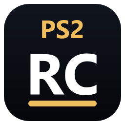

# PS2RC

<p align="center"></p>

<p align="center"><b>Join the community on Discord: <a href="https://discord.gg/wV8x46ZTDu">discord.gg/wV8x46ZTDu</a></b></p>

> **Read [LICENSE](LICENSE) before you use the code.** This is free, source-available
> software. You may use it, fork it, change it and share your work for free, as long as you
> credit the original (see [Forks](#forks)).
> **No game data is included here**, and none may ever be added: you bring a disc you legally own.

PS2RC is a **converter**: it turns a PlayStation 2 game disc that you own into a game folder for the
**Sony PSP**, entirely on your own PC. Under the hood it is a static recompiler: it translates the game's
PS2 program into C, builds it with the open-source PSP toolchain together with a runtime that stands in for
the parts of the PS2 the PSP does not have, and stages the result for a PSP with custom firmware.
PS2RC is developed as a converter for the PS2 version of Grand Theft Auto: San Andreas (PAL disc SLES-52541, version 2.01).
It is an independent project, see [Not affiliated](#not-affiliated).

```
your disc image -> PS2RC converter (on your PC) -> PSP/GAME/<folder> -> PSP (custom firmware)
```

## Status of this repository

| Part | Here |
|---|---|
| Converter, command line (`python -m ps2rc.convert`): identify the disc, translate, build, stage, check and repair a PSP folder | yes |
| Converter window (`gui/`, Qt for Python): disc -> PSP folder wizard, menu icon / pictures / music of your choice, settings | yes (source; `gui/build_app.py` builds the Windows app folder) |
| Recompiler (R5900 to C), IOP module recompiler, VU0 microcode translator, runtime, PSP platform layer | yes |
| Example pack (`games/example`): a small PS2 program written for this repository | yes |
| **Game pack for the disc above** (in `games/`: the per-game part the converter needs; its README has the controls, the settings and what differs from the developer build) | yes |

Nothing made from a game is, or will be, in this repository or its releases: no game files, no translated
code, no EBOOT built from a game. Everything made from the game is generated on the player's PC from the
player's own disc and never leaves it.

## What you need

- A disc image made from **a disc you legally own** (for the supported disc: the PAL disc named above, version
  2.01, as an ISO made with a PC drive).
- A **PSP-2000 or PSP-3000** (64 MB of RAM) with custom firmware (ARK) and ARK's extra memory on ("Use Extra
  Memory"): the runtime uses the large user memory partition, a small kernel-mode helper module and the Media
  Engine. The PSP Go also has 64 MB (untested). **The PSP-1000 is not supported**: it has 32 MB (24 MB for games)
  and the converted game needs about 50 MB (translated code ~13 MB + the PS2's RAM ~28 MB + buffers); it shows a
  "not supported" screen and returns to the menu. About 4 GB free on the memory stick.
- A **64-bit Windows 10 (1809 or newer) or Windows 11** PC for the ready-made converter. From source the
  converter also runs on Linux and macOS with the pspdev toolchain.

## Convert your disc (ready-made converter, nothing to install)

1. Download the converter archive from the Releases page of this repository and unpack it anywhere (the path may
   contain spaces; keep the folder together).
2. Double-click **PS2RC Converter.exe**. Pick your disc image, pick the memory stick (or an output folder),
   optionally your own menu icon / pictures / music, then **Convert**. About 10 minutes on a 12-thread PC.
3. If you converted into a folder: copy the converted folder (its name is shown at the end) to `PSP/GAME/` on the memory stick. Start it from the PSP
   menu.

The command line of the same folder: `ps2rc-convert.cmd <your disc image> --out <folder>` (options:
`ps2rc-convert.cmd --help`). The game pack's README (in `games/`) explains the controls and the settings
file. Everything the converter makes stays on your PC: never share the folder it makes.

## Controls (PSP)

The PSP has no L2, R2, L3, R3 and no right stick. **SELECT is a modifier**: hold it and press a second
button. SELECT itself still reaches the game as SELECT (the game changes the camera view when SELECT is
pressed), so the view may change once when you press SELECT; press it again to get the view back, or set
`select_to_game=tap` (see below).

| PSP | PS2 |
|---|---|
| Cross, Circle, Square, Triangle | the same |
| L / R | L1 / R1 |
| START / SELECT | START / SELECT |
| D-pad | D-pad |
| analog stick | left stick |
| SELECT + L | L2 |
| SELECT + R | R2 |
| SELECT + Triangle | L3 (left stick click) |
| SELECT + Circle | R3 (right stick click) |
| SELECT + D-pad | right stick, full deflection (camera); two directions at once give a diagonal |
| SELECT + Up | right stick up (default); with `select_up=r3` or `select_up=l3` in `ps2rc.cfg` it is R3 / L3 instead |

Port functions: **L + R + SELECT** shows or hides the frames-per-second counter (`show_fps` in the settings
file sets it at start). HOME -> Exit returns to the PSP menu. Avoid L + R + Down + START: custom firmware uses it
for its own menu.

### Change the controls

The table above is the built-in layout. Every PS2 button the PSP lacks can be moved to other buttons in
`ps2rc.cfg` (section CONTROLS; the converter's settings page shows the same choices as lists). A combination is
two or three buttons joined with `+`: `select start l r up down left right triangle circle cross square`.
Examples:

- `select_to_game=tap` - SELECT reaches the game only when pressed and released alone, so combinations no longer
  change the camera view.
- `map_l2=l+r` and `map_r2=r+square` - L2 on L and R together, R2 on R and Square.
- `map_rstick=r+analog` - hold R and use the analog stick to move the right stick (camera, hydraulics).

Other keys: `modifier` (`select`, `l`, `r` or `none`: the button the built-in combinations use), `map_l3`,
`map_r3`, `map_l1`, `map_r1`, `map_select`, `map_start`. A value the game does not understand, two keys on the
same buttons, L + R + SELECT, HOME or L + R + Down + START: that key keeps its built-in value. `session.log` shows
the layout in effect in the line `controls: ...` and the reason for every value that was not used.

### What the game's button prompts mean on the PSP

The game shows PS2 buttons. The PS2 actions below follow the public PS2 control lists of the game (game guides, PlayStation section);
the PSP column is this port's mapping.

On foot:

| Action | PS2 | PSP |
|---|---|---|
| fire / attack | Circle | Circle |
| aim weapon, lock on | R1 | R |
| sprint | Cross | Cross |
| jump | Square | Square |
| enter / exit a vehicle | Triangle | Triangle |
| crouch | L3 | SELECT + Triangle |
| previous / next weapon or target | L2 / R2 | SELECT + L / SELECT + R |
| look behind | R3 | SELECT + Circle |
| move the camera | right stick | SELECT + D-pad |
| gang: follow / recruit (active mode) | D-pad Up | D-pad Up |
| gang: stop (passive mode) | D-pad Down | D-pad Down |
| talk: positive / negative answer | D-pad Right / Left | D-pad Right / Left |
| change the camera view | SELECT | SELECT |
| pause menu | START | START |

Cars and bikes:

| Action | PS2 | PSP |
|---|---|---|
| accelerate | Cross | Cross |
| brake / reverse | Square | Square |
| enter / exit | Triangle | Triangle |
| handbrake | R1 | R |
| vehicle weapon / fire (drive-by) | L1 | L |
| look left / look right | L2 / R2 | SELECT + L / SELECT + R |
| look behind | L2 + R2 | hold SELECT first, then press L and R together (pressing SELECT last while L and R are already held toggles the fps counter instead) |
| horn | L3 | SELECT + Triangle |
| start / stop a side mission (taxi, ambulance, police, fire truck) | R3 | SELECT + Circle |
| next / previous radio station | D-pad Up / Down | D-pad Up / Down |
| trip skip (taxi rides, some missions) | D-pad Right | D-pad Right |
| special control (hydraulics, turret, tow truck arm) | right stick | SELECT + D-pad |
| change the camera view | SELECT | SELECT |

Planes:

| Action | PS2 | PSP |
|---|---|---|
| accelerate / brake, reverse | Cross / Square | Cross / Square |
| roll left / right, pitch forward / back | left stick | analog stick |
| rudder left / right | L2 / R2 | SELECT + L / SELECT + R |
| fire / alternate fire | L1 / Circle | L / Circle |
| landing gear | R3 | SELECT + Circle |

Helicopters:

| Action | PS2 | PSP |
|---|---|---|
| ascend / descend | Cross / Square | Cross / Square |
| roll, pitch | left stick | analog stick |
| rudder left / right | L2 / R2 | SELECT + L / SELECT + R |
| fire / secondary fire | L1 / Circle | L / Circle |

Every PS2 control of the game is reachable on the PSP. Two-button PS2 combinations that also need SELECT (look
behind in a car) take a moment of practice: hold SELECT first.

### Hydraulics and the lowrider contest

Cars with hydraulics are driven with the **right stick** on the PS2: push it to raise or drop the front, the
back, a side or a single corner (diagonals). The game's help texts also use the stick clicks: R3 makes the car
hop, L3 locks the hydraulics in place (read from the game's own button codes; unverified on a PSP build).

On the PSP:

- **move the hydraulics**: hold SELECT and press the D-pad: Up = front, Down = back, Left / Right = the sides,
  two buttons together = a corner (Up + Left = front left, and so on). Keep `select_up` at its default (`stick`),
  otherwise Up gives a stick click instead of the front.
- **hop**: SELECT + Circle (R3). **Lock**: SELECT + Triangle (L3).

The lowrider contest (the bounce competition): the screen shows a row of arrows that move towards a marker;
push the right stick in the arrow's direction when the arrow reaches the marker, in time with the music. On the
PSP: **hold SELECT the whole time** (pressing it again changes the camera view) and **tap** the D-pad direction on
the beat - Up, Down, Left, Right, or two at once for a diagonal arrow. Release the D-pad between beats (each tap
is one move; the PSP's D-pad always gives the full stick deflection).

## Build from source

Windows 10/11 x64 (the commands are for the Windows command prompt; on Linux / macOS use `python3`):

1. Install **Python 3.11 or newer** (64-bit, python.org; tick "Add python.exe to PATH") and **git**.
2. Get the code and the Python packages:

   ```
   git clone https://github.com/SandstoneDev/PS2RC.git
   cd PS2RC
   python -m pip install pyelftools pillow pytest
   ```

3. Get a **PSP toolchain** (psp-gcc 15.2 with PSPSDK). One of:
   - the `toolchain` folder of the ready-made converter download above (a native Windows build): pass it with
     `--toolchain <folder>\toolchain` or set the environment variable `PS2RC_TOOLCHAIN`;
   - WSL2 with the official pspdev toolchain installed in `~/pspdev` of a WSL distribution
     ([pspdev install guide](https://pspdev.github.io/installation/windows.html)): the converter finds it there
     by itself;
   - build the native Windows toolchain yourself with the scripts in `tools/toolchain/` (MSYS2; see the comments
     at the top of `tools/toolchain/build_windows.sh`).
4. Optional: [ffmpeg](https://ffmpeg.org/) for the intro movies (`--ffmpeg <ffmpeg.exe>` or on PATH; without it
   the movies are skipped).
5. Check and convert:

   ```
   python -m ps2rc doctor --quick
   python -m pytest -q -m "not wsl and not oracle and not psp and not slow and not needs_game"
   python -m ps2rc.convert "<your disc image>" --out "<output folder>" --toolchain "<converter folder>\toolchain"
   ```

   `doctor` also lists what the developer pipeline would need (`local.toml`, an extracted disc folder, PPSSPP,
   PCSX2); the converter needs none of these. `--dry-run` prints the plan and writes nothing; `python -m ps2rc.convert --help` lists every option.
   `python -m ps2rc.convert verify <PSP folder>` checks a converted folder later; `update` repairs it and keeps
   your settings and saves (a folder made by version 0.1.0: your settings move into `ps2rc.cfg`, the old file stays
   next to it as `.old`).

The converter window from source: `python -m pip install --require-hashes -r gui/build_requirements_qt.txt`,
then `python gui/run_gui.py`. The ready-made folder itself is made by `python gui/build_app.py` (see the top of
that file).

The example pack goes through the whole pipeline without any game data (needs bash and a native gcc for the
host build):

```bash
bash mk/build.sh --pack example host      # translate + build for the PC
bash mk/run_host.sh --pack example        # run it on the PC
bash mk/build.sh --pack example psp       # build EBOOT.PBP for the PSP
```

## Layout

| Path | What it is |
|---|---|
| `ps2rc/` | the translator and pipeline (Python), the converter (`convert/`), the IOP recompiler (`iop/`), the VU0 microcode translator (`vu/`), movie tools (`movies/`), the EBOOT packer (`pbp/`), menu artwork helpers (`xmb/`) |
| `gui/` | the converter window and the script that builds the Windows app folder |
| `runtime/` | the runtime the generated C is compiled against |
| `hle/core/` | EE kernel, syscalls, hardware registers, Sony-library HLE, IOP RPC framework, disc and memory-card layers |
| `hle/host/`, `hle/psp/` | the PC and PSP platform layers |
| `audio/` | SPU2 model and audio output stage |
| `psp_exc/` | kernel-mode helper module for the PSP (crash handler, counters) |
| `mk/` | build and run scripts |
| `tools/` | analysis tools for PS2 ELF files, development tools, PSP toolchain scripts |
| `games/` | game packs: the disc above, `_template` and `example` |
| `tests/` | tests that need no game data |
| `docs/` | [architecture](docs/ARCHITECTURE.md), [porting guide](docs/PORTING_GUIDE.md), [game pack format](docs/GAME_PACK_FORMAT.md) |

## Porting another game

PS2RC's recompiler is game-neutral. The toolkit for porting other PS2 games, with an agent kit (instructions,
skills and field notes for an AI coding agent), is
[universal-ps2-recompiler](https://github.com/SandstoneDev/universal-ps2-recompiler). For general PSP
development see [psp-developer](https://github.com/SandstoneDev/psp-developer).

## Forks

You may fork this repository, change it and publish your fork and its releases under the licence. In short (the
[LICENSE](LICENSE) has the exact terms):

- everything you distribute must be **free**: no selling, renting, paywalls or
  subscriptions. Voluntary donations are fine as long as they gate nothing (no
  feature, build, download or early access tied to them);
- your README and every release page must carry this credit:

  ```
  Based on PS2RC by SandstoneDev
  https://github.com/SandstoneDev/PS2RC
  Community: https://discord.gg/wV8x46ZTDu
  ```

- the start-up credit screen (the splash with the QR code) is a build option (`--no-splash` for the converter,
  `SPLASH=0` for `mk/build.sh`): your fork may keep, change or remove it, as long as its README keeps the credit
  above with the link to the original repository, https://github.com/SandstoneDev/PS2RC;
- the PS2RC code in your fork stays under the PS2RC License; keep `LICENSE` and
  `NOTICE.md` with your source;
- **never distribute game data**: no game files, no disc images, and nothing
  translated or built from a game (generated C, EBOOTs of a commercial game). Every
  user builds from their own disc.

To port **other** games, [universal-ps2-recompiler](https://github.com/SandstoneDev/universal-ps2-recompiler) is the
agent kit for it, free, under the same licence. If you break the terms, your permission ends; SandstoneDev may restore
it in writing.

## Community

**Join the community** on Discord: [discord.gg/wV8x46ZTDu](https://discord.gg/wV8x46ZTDu) - questions, progress
reports, help with the converter. Please never post game files, disc images or converted folders there.
Contributions: read [CONTRIBUTING.md](CONTRIBUTING.md). Security problems: see
[SECURITY.md](SECURITY.md). Other contact: GitHub issues, the Discord, or
sandstonedevpsp@gmail.com.


**Takedown policy.** Rightsholders can reach the maintainer through GitHub issues,
the Discord or sandstonedevpsp@gmail.com. On a takedown or removal notice the named
material is removed promptly and not published again (no re-uploads or mirrors);
GitHub's DMCA process applies as usual. Details: [TAKEDOWN.md](TAKEDOWN.md).

## Credits

PS2RC is written by SandstoneDev. Thanks to the people and projects whose public work it uses or learned from. Each
keeps its own licence; the licence texts and what exactly was used are in [NOTICE.md](NOTICE.md).

People:

- **DenielX** ([github.com/DenielX](https://github.com/DenielX/), YouTube
  [@sp-pteam-indev6976](https://www.youtube.com/@sp-pteam-indev6976)) - for advice during development.
- **mcidclan** ([github.com/mcidclan](https://github.com/mcidclan)) - PSP Media Engine research: the runtime's Media
  Engine start-up follows the boot pattern of his
  [me-feed-graphics-engine](https://github.com/mcidclan/me-feed-graphics-engine) (MIT), and his Media Engine samples
  (memory map, spinlock, soft interrupts, DMA) and clock research shaped the Media Engine and overclock work.
- **aap**: MIT-licensed code adapted in the game pack for the PS2 texture layout (texel order, transfer sizes,
  palette order); its licence text is in the game pack's `NOTICE.md`.
- The posters of the ps2dev forum thread
  ["scePowerSetClockFrequency"](https://forums.ps2dev.org/viewtopic.php?t=7937) (2007): how the PSP's PLL, CPU and bus
  clocks relate, and why memory-bound code gains less from a higher CPU clock.

Used by PS2RC or shipped next to the converter as separate programs:

- [pspdev](https://github.com/pspdev): the PSP toolchain (GCC, binutils, newlib) and PSPSDK;
- [ARK custom firmware](https://github.com/PSP-Arkfive/ARK-5) ([ARK-4](https://github.com/PSP-Archive/ARK-4)): the
  KUBridge / SystemControl calls and the overclock and extra-memory interfaces it offers to homebrew;
- [FFmpeg](https://ffmpeg.org) (with libx264): intro movies, the animated menu icon and the menu music input;
- [atracdenc](https://github.com/dcherednik/atracdenc): the menu music (ATRAC3 / ATRAC3plus);
- [Qt for Python (PySide6)](https://www.pyside.org) and [Qt](https://www.qt.io): the converter window;
- [Python](https://www.python.org), [pyelftools](https://github.com/eliben/pyelftools) and
  [Pillow](https://python-pillow.org): the converter;
- [DejaVu fonts](https://dejavu-fonts.github.io/): the text of the start-up screen.

Studied as references (no code taken):

- [PCSX2](https://pcsx2.net/): the reference emulator for bit-exact tests (through its PINE interface);
- [PPSSPP](https://www.ppsspp.org/) and [pspautotests](https://github.com/hrydgard/pspautotests): the test emulator,
  its source and hardware notes (GE, VFPU, movies);
- [ps2sdk](https://github.com/ps2dev/ps2sdk): EE syscall numbers and the memory-card library's behaviour;
- [Play!](https://github.com/jpd002/Play-): the semantics of the EE kernel's syscalls;
- [PS2Recomp](https://github.com/ran-j/PS2Recomp) and [N64Recomp](https://github.com/N64Recomp/N64Recomp): static
  recompiler designs, and the library signature-scan method PS2RC re-implements;
- [ps2tek](https://psi-rockin.github.io/ps2tek/): PS2 hardware registers;
- [psx-spx](https://problemkaputt.de/psx-spx.htm): the PlayStation sound hardware;
- [uOFW](https://github.com/uofw/uofw), [vfpu-docs](https://github.com/pspdev/vfpu-docs),
  [PSPTEK](http://daifukkat.su/docs/psptek/): PSP firmware interfaces, the VFPU and the hardware maps.


## Not affiliated

This project is not affiliated with, authorized or endorsed by Rockstar Games, Take-Two Interactive or Sony Interactive Entertainment.
The game's title is used only to say which disc the converter is made for; all trademarks belong to their owners.
"PlayStation", "PS2" and "PSP" are trademarks of Sony Interactive Entertainment Inc.
